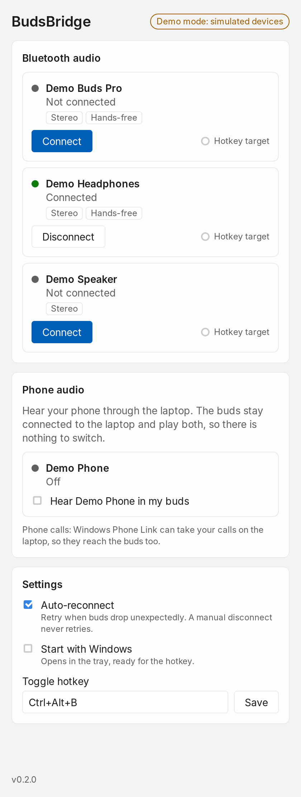
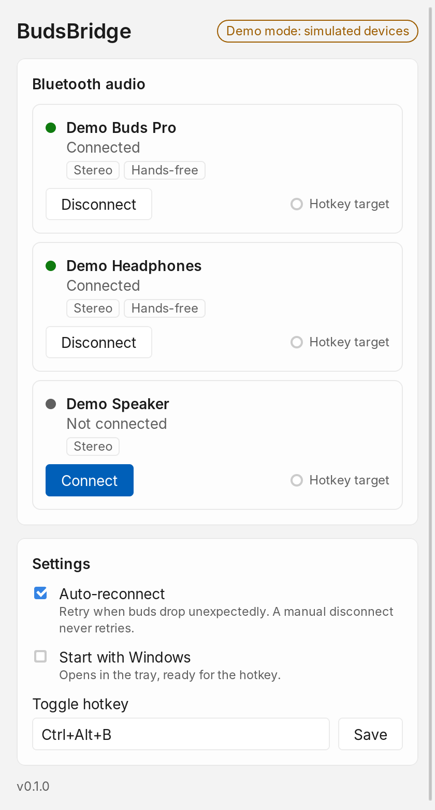
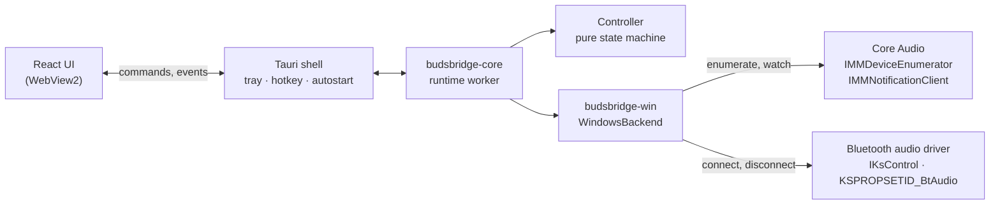
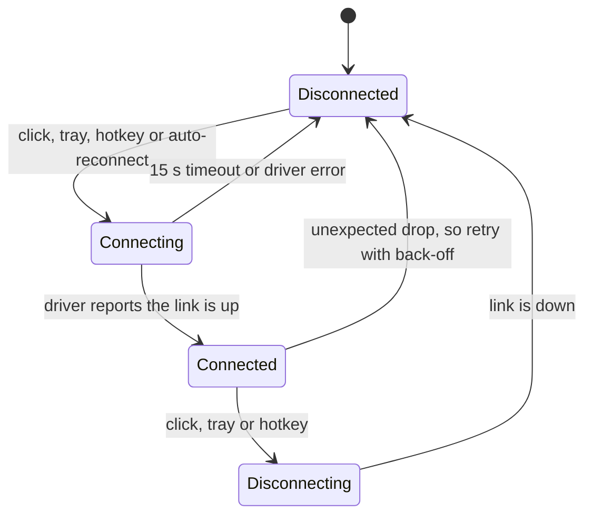

<div align="center">


<h1>BudsBridge</h1>

**Switch Bluetooth earbuds between your phone and your Windows laptop in one click, even when the buds don't support multipoint.**

A small tray app for Windows 11. It lists your paired Bluetooth audio devices, connects and disconnects them with a click or a global hotkey, and reconnects them on its own when they drop. Everything runs on your machine. A single `.exe`, no account, nothing to install on your phone.

[](https://github.com/shakaibarsalan/BudsBridge/releases)
[](docs/FEASIBILITY.md)

[](LICENSE)


<sub>Recorded in demo mode with simulated devices, so it runs anywhere: <b>Connect</b> goes through <i>Connecting…</i> to <i>Connected</i>, the buds become the hotkey target, <code>Ctrl+Alt+B</code> disconnects and reconnects them, the headphones are disconnected, and auto-reconnect is switched off and on. Also as <a href="docs/media/demo.mp4">MP4</a>. A video on real buds follows the first hardware run.</sub>

</div>

---

## The problem

My earbuds don't support multipoint, so they talk to one device at a time. Moving from my phone to my laptop meant opening Bluetooth settings on the phone, disconnecting, then going to the laptop and connecting, every single time. A lot of people with budget buds live with the same thing.

Software can't add multipoint: it is a feature of the earbuds' firmware, and no app on Windows or Android can change it ([why, with sources](docs/FEASIBILITY.md#1-why-the-problem-exists)). So BudsBridge works around it in two steps:

1. **Switch faster (built).** One click, a tray menu or a hotkey connects or releases the buds on the laptop, and it reconnects them if they drop out of range.
2. **Stop switching (next).** The buds stay on the laptop and the phone's audio comes to the laptop, over Bluetooth with the laptop acting as a speaker, or over USB/Wi-Fi. Windows mixes it with the laptop's own sound, so you hear both and never switch at all.

## What it does

| | |
|---|---|
| **See your audio devices** | every paired Bluetooth headset, earbud and speaker in one list, with its live state and profiles (Stereo for music, Hands-free for calls). One pair of buds shows up once, not as separate "Headphones" and "Headset" entries |
| **Connect and disconnect** | one click in the window or in the tray menu. The state moves through *Connecting…* to *Connected*, and if the buds don't answer within 15 s you get a clear message instead of a spinner |
| **Hotkey** | `Ctrl+Alt+B` toggles your chosen buds from any app. Pick them with **Hotkey target**, change the key combination in Settings, or leave the field empty to turn it off |
| **Auto-reconnect** | if the buds drop unexpectedly, out of range or the case closed, BudsBridge retries after 1 s, 2 s, 4 s … up to 30 s, eight times. It never retries after *you* disconnect, so the laptop doesn't fight your phone for the buds |
| **Tray icon** | a filled icon while buds are connected and an outline when not, a tooltip naming what's connected, and a menu to toggle each device, switch auto-reconnect, open the window or quit. Closing the window keeps BudsBridge in the tray |
| **Start with Windows** | starts minimized to the tray, ready for the hotkey |
| **Windows 11 look** | Mica backdrop, and light and dark mode follow your system setting |

## How to use it

| | |
|---|---|
|  | **1. Pair once, then open BudsBridge.** Pair the buds with the laptop in **Settings → Bluetooth & devices** the usual way. BudsBridge lists them, plus anything else you've paired. A green dot means connected. |
|  | **2. Connect.** Take the buds out of the case, make sure the phone isn't holding them, and click **Connect**. You'll see *Connecting…* while Windows brings up the link. |
|  | **3. Listen.** Once connected the dot turns green, the tray icon fills in, and Windows routes the sound to the buds. **Disconnect** hands them back, for example to your phone. |
|  | **4. Make it one keystroke.** Mark your buds as **Hotkey target**, and from then on `Ctrl+Alt+B` connects or releases them from anywhere. Below that, choose auto-reconnect, start with Windows, and the key combination. |

<p align="center"><br><sub>Light and dark follow the system theme. On Windows 11 the window also gets the Mica backdrop, which this Linux recording can't show.</sub></p>

## Install

From [Releases](https://github.com/shakaibarsalan/BudsBridge/releases):

| File | What it is |
|---|---|
| `BudsBridge.exe` | a single file, no installer: download it and open it |
| `BudsBridge-<version>-windows-x64-setup.exe` | installer for your user only: Start menu entry and uninstaller, no admin prompt |
| `SHA256SUMS.txt` | checksums for both |

**Nothing else needs to be installed.** Windows 11 already has the WebView2 runtime the window uses, and the phone needs no app for any of this. The only setup is pairing the buds with Windows once.

The build isn't code-signed, so the first time Windows shows *"Windows protected your PC"*: click **More info → Run anyway**.

### Or build it yourself

Windows 11 with Rust (stable, MSVC), Node.js 22+ and pnpm 10:

```bash
git clone https://github.com/shakaibarsalan/BudsBridge.git
cd BudsBridge/apps/desktop
pnpm install
pnpm tauri dev      # run it
pnpm tauri build    # target/release/budsbridge.exe and an NSIS installer
```

<details>
<summary>Demo mode and the hardware check tool</summary>

```powershell
$env:BUDSBRIDGE_DEMO = "1"; pnpm tauri dev                          # simulated devices, works on any OS
cargo run -p budsbridge-win --example bt-audio -- list              # real devices, Windows only
cargo run -p budsbridge-win --example bt-audio -- connect "{id-from-list}"
```

Settings live in `%APPDATA%\io.github.shakaibarsalan.budsbridge\settings.json`, and logs in `%LOCALAPPDATA%\io.github.shakaibarsalan.budsbridge\logs`.
</details>

## How it works

Windows has no public "connect this headset" API. Bluetooth audio drivers do accept a kernel-streaming request, `KSPROPSETID_BtAudio` with `KSPROPERTY_ONESHOT_RECONNECT` / `KSPROPERTY_ONESHOT_DISCONNECT`, which is what the **Connect** button in the classic Sound control panel uses. BudsBridge finds each Bluetooth render endpoint through Core Audio, follows its connector to the driver's KS filter, and sends the request through `IKsControl`. The open-source [ToothTray](https://github.com/m2jean/ToothTray) project showed this works from a normal app.



The decisions live in a pure state machine: commands, device snapshots and time go in, actions come out. It never reads the clock or calls the OS itself, so every transition is unit-tested.



| Piece | Role |
|---|---|
| [`budsbridge-core`](crates/budsbridge-core) | device model, connection state machine, reconnect back-off, settings, and the runtime worker that drives a backend. No OS code |
| [`budsbridge-win`](crates/budsbridge-win) | Windows backend: Bluetooth endpoints grouped by device container, KS connect/disconnect, change notifications, plus the `bt-audio` CLI |
| [`apps/desktop`](apps/desktop) | Tauri 2 app: window, tray, global hotkey, start with Windows, React UI |

The reasoning behind every choice, including what is impossible, is in [docs/FEASIBILITY.md](docs/FEASIBILITY.md) and [docs/ARCHITECTURE.md](docs/ARCHITECTURE.md).

## Roadmap

| Step | Status |
|---|---|
| Device list, connect/disconnect, tray, hotkey, auto-reconnect, start with Windows | built, waiting on the [hardware check](docs/HARDWARE_TESTING.md) |
| Final UI from the reference design | waiting on the design |
| Phone audio to the laptop over Bluetooth (the laptop acts as a speaker) | next |
| Phone audio over USB or Wi-Fi ADB (bundled scrcpy, audio only) | planned |
| Audio sources panel with per-source volume and a latency indicator | planned |
| Priority and ducking between laptop and phone audio | planned |

## Honest notes

- **Not tested on real buds yet.** It builds, lints clean and passes every test on Linux and Windows in CI, and it runs end to end in demo mode. The first real-hardware run is the next step, and this README will say what it found.
- **No software multipoint.** Non-multipoint buds hold one device at a time. BudsBridge makes the hand-over quick, but it can't make them talk to two at once.
- **Busy buds may ignore the laptop.** While the buds are connected to the phone, many models ignore the laptop until the phone lets go, and others jump to the laptop. Which one yours do is item S2 of the [hardware checklist](docs/HARDWARE_TESTING.md).
- **It depends on the Bluetooth driver.** Connecting needs a driver that implements `KSPROPSETID_BtAudio`. The Microsoft in-box stack is expected to, but some vendor stacks may not. BudsBridge shows that as an error instead of failing silently.
- **Mic use lowers quality.** When any app uses the buds' mic, Classic Bluetooth switches to the hands-free profile and all sound becomes mono and low fidelity. LE Audio on Windows 11 24H2 avoids this, but only when the radio, driver and buds all support it.
- **Fully automatic switching back to the phone isn't possible from a normal Android app**, because Android has no public API to connect a specific headset ([details](docs/FEASIBILITY.md#7-phase-3-auto-switch-what-is-really-possible)).

## FAQ

**Do I need to install anything on my phone?**
No. For switching, the phone only needs Bluetooth. The phone-audio bridge planned next also starts without a phone app, because the laptop can act as a Bluetooth speaker.

**My buds support multipoint. Do I need this?**
Probably not: multipoint buds already stay connected to both. BudsBridge is for the many that don't.

**Which buds work?**
Anything Windows lists as a Bluetooth audio device: earbuds, headphones, speakers. How fast the switch is depends on the buds and the laptop's Bluetooth driver; the [hardware checklist](docs/HARDWARE_TESTING.md) measures it.

**Does it send anything over the internet?**
No. There is no account, no telemetry and no network code. It talks to Windows' audio and Bluetooth stack only.

**Why does Windows warn me when I open it?**
The `.exe` isn't code-signed, because a certificate costs money. SmartScreen shows the warning once; **More info → Run anyway**.

## How it's built

Rust and [Tauri 2](https://tauri.app), with a React 19 + TypeScript UI. Windows APIs (Core Audio, kernel streaming, COM) come through Microsoft's [`windows`](https://github.com/microsoft/windows-rs) crate. The logic is OS-independent and tested with an in-memory backend: 44 Rust tests for the state machine, reconnect policy, settings and runtime, more for endpoint grouping and the tray labels, and 16 Vitest tests for the UI. CI runs rustfmt, clippy (warnings are errors) and all tests on Linux and Windows, builds the installer, and a tag publishes a release.

The demo and screenshots above are recorded by [`scripts/record-demo.sh`](scripts/record-demo.sh). It starts the app in demo mode on a virtual display, clicks through the flow with `xdotool`, and captures it with `ffmpeg`, so every run of the script produces the same media.

```
BudsBridge/
├── crates/
│   ├── budsbridge-core/     device model, state machine, reconnect policy, settings, runtime
│   └── budsbridge-win/      Windows backend (Core Audio + KS), examples/bt-audio.rs CLI
├── apps/desktop/
│   ├── src/                 React UI and its tests
│   └── src-tauri/           Tauri shell: window, tray, hotkey, autostart, commands
├── scripts/record-demo.sh   records the README media in demo mode
├── docs/                    feasibility study, architecture, hardware checklist, releases
└── .github/workflows/       CI and release
```

Running the tests and the other development commands are in [docs/DEVELOPMENT.md](docs/DEVELOPMENT.md).

## Author

Built by **Muhammad Shakaib Arsalan**, for my own buds first.

[Portfolio](https://shakaib.vercel.app) · [LinkedIn](https://www.linkedin.com/in/shakaib-arsalan) · [GitHub](https://github.com/shakaibarsalan)

## License

MIT. See [LICENSE](LICENSE).
