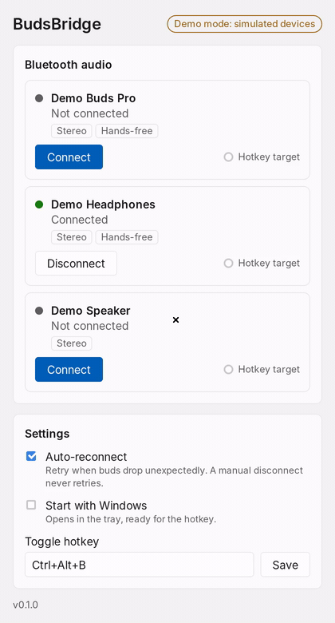
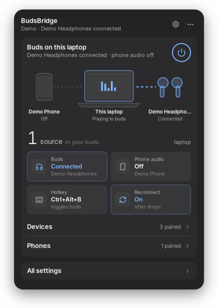
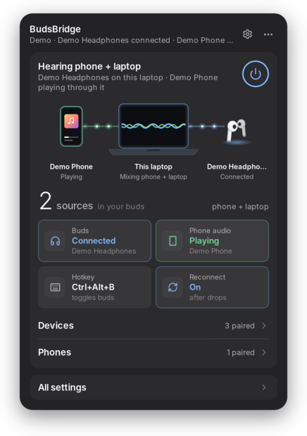
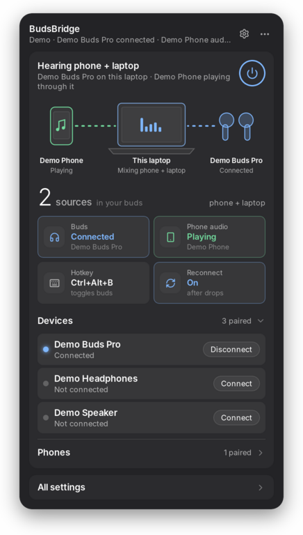
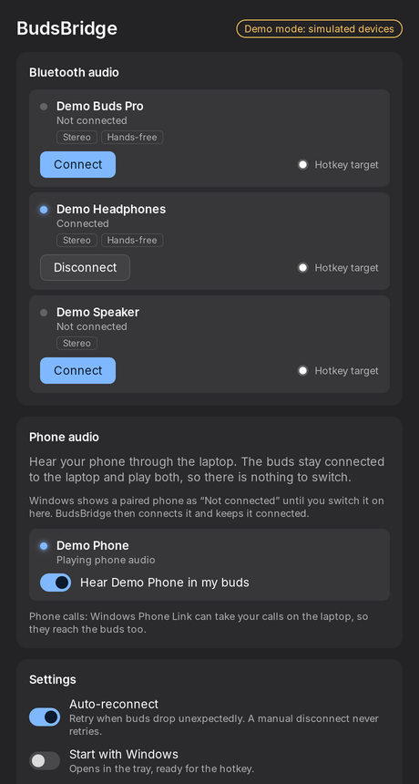
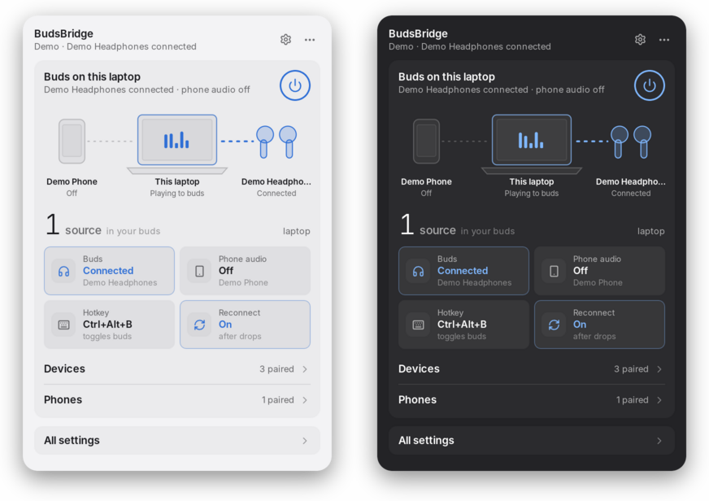
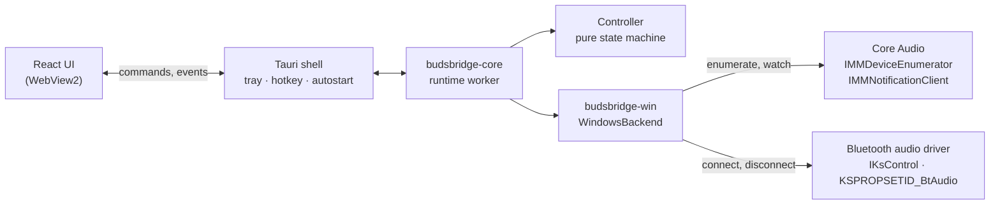
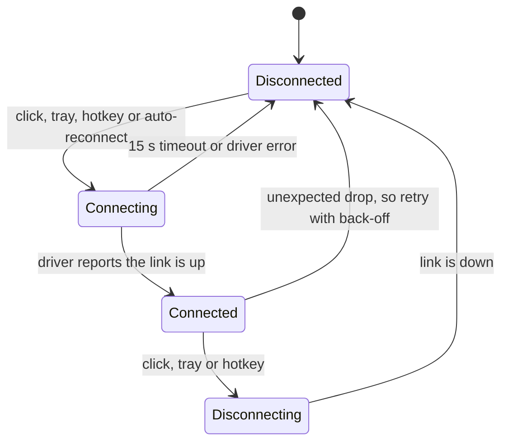

<div align="center">


<h1>BudsBridge</h1>

**Hear your phone and your laptop in the same Bluetooth buds, even buds without multipoint.**

A small dock for Windows 11 that opens from the tray. The buds stay connected to the laptop, and your phone plays its audio through the laptop into the same buds, so you hear both and never switch. When you do want the buds back on the phone, one click or a hotkey hands them over. Everything runs on your machine. A single `.exe`, no account, nothing to install on your phone.

[](https://github.com/shakaibarsalan/BudsBridge/releases/latest)
[](docs/FEASIBILITY.md)

[](LICENSE)




<sub>The dock, recorded in demo mode with simulated devices so it runs anywhere: the <b>Phone audio</b> tile brings the phone in (the green link, now <i>2 sources</i> in the buds), the <b>Buds</b> tile hands the buds back, <code>Ctrl+Alt+B</code> brings them back from anywhere, and <b>Devices</b> opens the full list in place. Also as <a href="docs/media/demo.mp4">MP4</a>.</sub>

</div>

---

## The problem

My earbuds don't support multipoint, so they talk to one device at a time. Moving from my phone to my laptop meant opening Bluetooth settings on the phone, disconnecting, then going to the laptop and connecting, every single time. A lot of people with budget buds live with the same thing.

Software can't make the buds hold two connections: that is multipoint, a feature of the earbuds' firmware, and no app on Windows or Android can change it ([why, with sources](docs/FEASIBILITY.md#1-why-the-problem-exists)). So BudsBridge gets the same result a different way:

```
Phone ──Bluetooth──► Laptop ──Bluetooth──► Buds
                       ▲
       the laptop's own sound (YouTube, Zoom)
```

1. **Stop switching: bridge mode.** The buds stay connected to the laptop only. The phone connects to the laptop too, as if the laptop were a Bluetooth speaker, and Windows mixes the phone's audio with the laptop's into the buds. You hear both, and nothing switches.
2. **Switch fast when you leave.** When you walk away from the laptop, one click, the tray menu or `Ctrl+Alt+B` releases the buds for your phone, and connects them back when you return.

## What it does

| | |
|---|---|
| **Tray dock** | click the tray icon and a small panel opens beside it, like a Mac menu bar app: a live picture of what plays where (phone → laptop → buds), how many sound sources reach your buds, four tiles that are also the switches, and the device and phone lists. It closes when you click elsewhere. The full window only opens for **All settings** |
| **Phone audio (bridge mode)** | turn on **Hear my phone in my buds** once and the phone's music, videos and voice notes play through the laptop into the buds, mixed with the laptop's sound. It stays on: if the phone goes away it waits and reconnects (5 s, 10 s, 20 s, 40 s, then every minute), and it comes back on by itself after a restart |
| **See your audio devices** | every paired Bluetooth headset, earbud and speaker in one list, with its live state and profiles (Stereo for music, Hands-free for calls). One pair of buds shows up once, not as separate "Headphones" and "Headset" entries |
| **Connect and disconnect** | one click on the **Buds** tile, the power button, the device list or the tray menu. The state moves through *Connecting…* to *Connected*, and if the buds don't answer within 15 s you get a clear message instead of a spinner |
| **Hotkey** | `Ctrl+Alt+B` toggles your chosen buds from any app. Pick them with **Hotkey target**, change the key combination in Settings, or leave the field empty to turn it off |
| **Auto-reconnect** | if the buds drop unexpectedly, out of range or the case closed, BudsBridge retries after 1 s, 2 s, 4 s … up to 30 s, eight times. It never retries after *you* disconnect, so the laptop doesn't fight your phone for the buds |
| **Tray icon** | a filled icon while buds are connected and an outline when not, and a tooltip naming what's connected. Left-click opens the dock; right-click has a menu to toggle each device and phone, switch auto-reconnect, open settings or quit |
| **Start with Windows** | starts minimized to the tray, ready for the hotkey |
| **Windows 11 look** | Mica backdrop, and light and dark mode follow your system setting |

## How to use it

| | |
|---|---|
|  | **1. Pair once, then open the dock.** Pair the buds (and, for phone audio, your phone) with the laptop in **Settings → Bluetooth & devices**. Click the BudsBridge icon in the tray: the dock shows what is connected, as a picture and as tiles. |
|  | **2. Hear your phone too.** Click the **Phone audio** tile. After *Connecting…* the link turns green, the headline says *Hearing phone + laptop* and the count shows **2 sources**: whatever plays on the phone now plays in the buds, along with the laptop. |
|  | **3. Switch with one click or a key.** The **Buds** tile or the power button connects or releases the buds; `Ctrl+Alt+B` does the same from any app. **Devices** and **Phones** open the full lists in place. |
|  | **4. Settings, only when you want them.** **All settings** (or the gear) opens the full window: pick the hotkey target and key combination, auto-reconnect, start with Windows, and every device and phone. |

<p align="center"><br><sub>Light and dark follow the system theme. On Windows 11 the dock and the window also get the Mica backdrop, which this Linux recording can't show.</sub></p>

## Install

From the [latest release](https://github.com/shakaibarsalan/BudsBridge/releases/latest):

| File | What it is |
|---|---|
| `BudsBridge.exe` | a single file, no installer: download it and open it |
| `BudsBridge-<version>-windows-x64-setup.exe` | installer for your user only: Start menu entry and uninstaller, no admin prompt |
| `SHA256SUMS.txt` | checksums for both |

Opening a newer `BudsBridge.exe` while an older copy runs in the tray hands over to the new one (from 0.3.1 on; quit older copies from the tray first).

**Nothing else needs to be installed.** Windows 11 already has the WebView2 runtime the window uses, and the phone needs no app for any of this. The only setup is pairing the buds with Windows once.

The build isn't code-signed, so the first time Windows shows *"Windows protected your PC"*: click **More info → Run anyway**.

### Or build it yourself

Windows 11 with Rust (stable, MSVC), Node.js 22+ and pnpm 10:

```bash
git clone https://github.com/shakaibarsalan/BudsBridge.git
cd BudsBridge/apps/desktop
pnpm install
pnpm tauri dev      # run it
pnpm tauri build    # target/release/budsbridge.exe and an NSIS installer
```

<details>
<summary>Demo mode and the hardware check tool</summary>

```powershell
$env:BUDSBRIDGE_DEMO = "1"; pnpm tauri dev                          # simulated devices, works on any OS
cargo run -p budsbridge-win --example bt-audio -- list              # real devices, Windows only
cargo run -p budsbridge-win --example bt-audio -- connect "{id-from-list}"
```

Settings live in `%APPDATA%\io.github.shakaibarsalan.budsbridge\settings.json`, and logs in `%LOCALAPPDATA%\io.github.shakaibarsalan.budsbridge\logs`.
</details>

## How it works

Windows has no public "connect this headset" API. Bluetooth audio drivers do accept a kernel-streaming request, `KSPROPSETID_BtAudio` with `KSPROPERTY_ONESHOT_RECONNECT` / `KSPROPERTY_ONESHOT_DISCONNECT`, which is what the **Connect** button in the classic Sound control panel uses. BudsBridge finds each Bluetooth render endpoint through Core Audio, follows its connector to the driver's KS filter, and sends the request through `IKsControl`. The open-source [ToothTray](https://github.com/m2jean/ToothTray) project showed this works from a normal app.



The decisions live in a pure state machine: commands, device snapshots and time go in, actions come out. It never reads the clock or calls the OS itself, so every transition is unit-tested.



| Piece | Role |
|---|---|
| [`budsbridge-core`](crates/budsbridge-core) | device model, connection state machine, reconnect back-off, settings, and the runtime worker that drives a backend. No OS code |
| [`budsbridge-win`](crates/budsbridge-win) | Windows backend: Bluetooth endpoints grouped by device container, KS connect/disconnect, change notifications, plus the `bt-audio` CLI |
| [`apps/desktop`](apps/desktop) | Tauri 2 app: window, tray, global hotkey, start with Windows, React UI |

The reasoning behind every choice, including what is impossible, is in [docs/FEASIBILITY.md](docs/FEASIBILITY.md) and [docs/ARCHITECTURE.md](docs/ARCHITECTURE.md).

## Roadmap

| Step | Status |
|---|---|
| Device list, connect/disconnect, tray, hotkey, auto-reconnect, start with Windows | built; device listing confirmed on real hardware, switching awaiting the [hardware check](docs/HARDWARE_TESTING.md) |
| Bridge mode: phone audio through the laptop over Bluetooth | built and working on the first real test (Windows 11 laptop, OPPO A83, TWS buds); delay and stutter not measured yet |
| Tray dock and settings window in the InverterBar style | built |
| Phone audio over USB or Wi-Fi ADB (bundled scrcpy, audio only) | planned |
| Audio sources panel with per-source volume and a latency indicator | planned |
| Priority and ducking between laptop and phone audio | planned |

## Honest notes

- **Tested on one real setup so far.** On a Windows 11 laptop with TWS buds and an OPPO A83 Android phone, BudsBridge lists the paired devices correctly and bridge mode plays the phone through the laptop into the buds. Delay and stutter haven't been measured yet, and the rest of the [hardware checklist](docs/HARDWARE_TESTING.md) is still to run; this README will be updated with what it finds.
- **Not every phone works with Windows' phone audio.** On the same laptop a Pixel 7 was listed but its audio never started, and after re-pairing Windows stopped offering it at all, while the OPPO A83 works. A user of another app built on the same Windows feature reports the same with a Pixel 7. BudsBridge now lists such a phone with the reason instead of hiding it, and **Copy diagnostics** in settings shows what Windows reports, so the cause can be found.
- **Bridge mode is "dual connectivity" through the laptop, not in the buds.** The buds still hold one link, to the laptop. You hear the phone only while the laptop is on and in range; away from it, hand the buds to the phone.
- **Phone audio arrives a little late**, roughly 0.2–0.4 s, because it makes two Bluetooth hops. Fine for music and podcasts; lip-sync is off if you watch a video on the phone's own screen.
- **Two Bluetooth audio streams at once can stutter on some laptops**, because one radio carries both. Item B3 of the [hardware checklist](docs/HARDWARE_TESTING.md) checks yours.
- **No software multipoint.** Non-multipoint buds hold one device at a time. BudsBridge makes the hand-over quick, but it can't make them talk to two at once.
- **Busy buds may ignore the laptop.** While the buds are connected to the phone, many models ignore the laptop until the phone lets go, and others jump to the laptop. Which one yours do is item S2 of the [hardware checklist](docs/HARDWARE_TESTING.md).
- **It depends on the Bluetooth driver.** Connecting needs a driver that implements `KSPROPSETID_BtAudio`. The Microsoft in-box stack is expected to, but some vendor stacks may not. BudsBridge shows that as an error instead of failing silently.
- **Mic use lowers quality.** When any app uses the buds' mic, Classic Bluetooth switches to the hands-free profile and all sound becomes mono and low fidelity. LE Audio on Windows 11 24H2 avoids this, but only when the radio, driver and buds all support it.
- **Fully automatic switching back to the phone isn't possible from a normal Android app**, because Android has no public API to connect a specific headset ([details](docs/FEASIBILITY.md#7-phase-3-auto-switch-what-is-really-possible)).

## FAQ

**Is this real dual connectivity?**
For your ears, yes: phone and laptop play in the same buds at the same time, with no switching. Technically the buds connect only to the laptop, and the phone's sound reaches them through the laptop. True two-link multipoint has to be built into the buds' firmware, which no app can add.

**Do I need to install anything on my phone?**
No. The phone only needs Bluetooth and to be paired with the laptop once; the laptop acts as a Bluetooth speaker for it.

**What about phone calls?**
Microsoft's Phone Link (built into Windows 11) can take your phone's calls on the laptop, and the laptop plays them in the buds and uses their mic. Call audio uses Bluetooth's hands-free mode, which sounds lower quality than music.

**My buds support multipoint. Do I need this?**
Probably not: multipoint buds already stay connected to both. BudsBridge is for the many that don't.

**Which buds work?**
Anything Windows lists as a Bluetooth audio device: earbuds, headphones, speakers. How fast the switch is depends on the buds and the laptop's Bluetooth driver; the [hardware checklist](docs/HARDWARE_TESTING.md) measures it.

**Does it send anything over the internet?**
No. There is no account, no telemetry and no network code. It talks to Windows' audio and Bluetooth stack only.

**Why does Windows warn me when I open it?**
The `.exe` isn't code-signed, because a certificate costs money. SmartScreen shows the warning once; **More info → Run anyway**.

## How it's built

Rust and [Tauri 2](https://tauri.app), with a React 19 + TypeScript UI. Windows APIs (Core Audio, kernel streaming, COM) come through Microsoft's [`windows`](https://github.com/microsoft/windows-rs) crate. Bridge mode uses Windows' own `AudioPlaybackConnection`, which turns the laptop into a Bluetooth speaker for a paired phone. The dock's look follows the menu bar panel of [InverterBar](https://github.com/ahkamboh/inverterbar): monochrome surfaces, restrained accents for what is live, and a hero picture that is a pure function of the current state. The logic is OS-independent and tested with in-memory backends: 57 Rust tests for the switching and bridge state machines, reconnect policies, settings and runtimes, more for endpoint naming, dock placement on any taskbar edge and the tray labels, and 39 Vitest tests for the dock and the settings window. CI runs rustfmt, clippy (warnings are errors) and all tests on Linux and Windows, builds the installer, and a tag publishes a release.

The demo and screenshots above are recorded by [`scripts/record-demo.sh`](scripts/record-demo.sh). It starts the app in demo mode on a virtual display, clicks through the flow with `xdotool`, and captures it with `ffmpeg`, so every run of the script produces the same media.

```
BudsBridge/
├── crates/
│   ├── budsbridge-core/     device model, state machine, reconnect policy, settings, runtime
│   └── budsbridge-win/      Windows backend (Core Audio + KS), examples/bt-audio.rs CLI
├── apps/desktop/
│   ├── src/                 React UI and its tests
│   └── src-tauri/           Tauri shell: window, tray, hotkey, autostart, commands
├── scripts/record-demo.sh   records the README media in demo mode
├── docs/                    feasibility study, architecture, hardware checklist, releases
└── .github/workflows/       CI and release
```

Running the tests and the other development commands are in [docs/DEVELOPMENT.md](docs/DEVELOPMENT.md).

## Author

Built by **Muhammad Shakaib Arsalan**, for my own buds first.

[Portfolio](https://shakaib.vercel.app) · [LinkedIn](https://www.linkedin.com/in/shakaib-arsalan) · [GitHub](https://github.com/shakaibarsalan)

## License

MIT. See [LICENSE](LICENSE).
