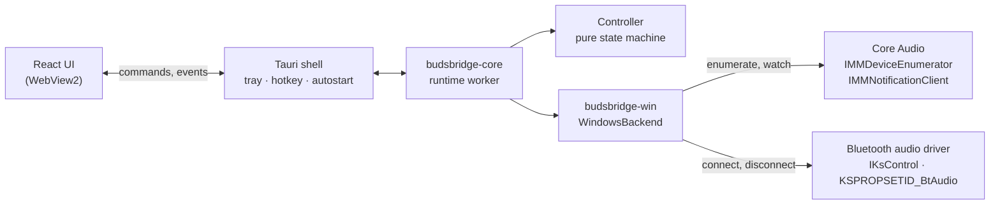
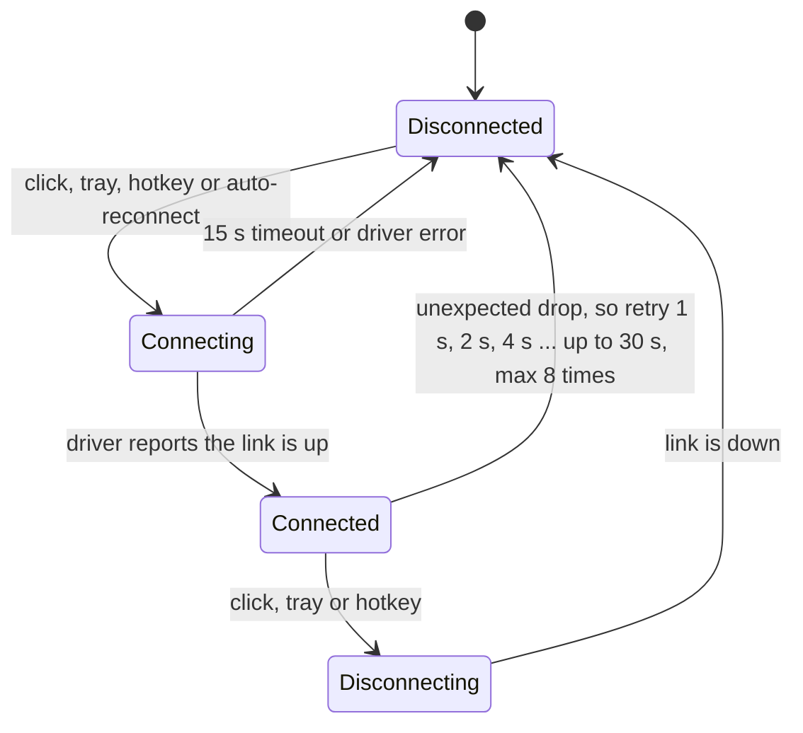

# BudsBridge

One-click and hotkey switching on Windows for Bluetooth earbuds that can only connect to one device at a time. The next phase keeps the buds on the laptop and brings the phone's audio to them.

<!-- Demo GIF placeholder: record on real hardware after the checklist in docs/HARDWARE_TESTING.md, save as docs/images/demo.gif and replace this comment with  -->
<sub>Demo GIF coming after the first real-hardware run. Until then, `BUDSBRIDGE_DEMO=1` runs the app with simulated devices.</sub>

## What it does

My earbuds don't support multipoint, so moving from my phone to my laptop meant disconnecting in one place and reconnecting in the other, every time. A lot of people with budget buds have the same problem.

Software can't add multipoint. It is a feature of the earbuds' firmware, and no app on Windows or Android can change it ([why, with sources](docs/FEASIBILITY.md#1-why-the-problem-exists)). BudsBridge works around it in two steps:

1. **Switch faster (MVP, built).** See your paired Bluetooth audio devices and connect or disconnect them with one click, a tray menu or a global hotkey (`Ctrl+Alt+B`). If the buds drop out of range, it reconnects them with back-off. After you disconnect them yourself, it leaves them alone so the laptop never fights your phone for them.
2. **Stop switching (Phase 2, planned).** The buds stay on the laptop and the phone's audio comes to the laptop: over Bluetooth (the laptop acts as a speaker), USB or Wi-Fi ADB (scrcpy), or Wi-Fi. Windows mixes it with the laptop's own sound, so you hear both in the buds and never switch at all.

## How it works

Windows has no public "connect this headset" API. Bluetooth audio drivers do accept a kernel-streaming property, `KSPROPSETID_BtAudio` with `KSPROPERTY_ONESHOT_RECONNECT` / `KSPROPERTY_ONESHOT_DISCONNECT`. The **Connect** button in the classic Sound control panel uses the same mechanism. BudsBridge finds each Bluetooth render endpoint through Core Audio, follows its connector to the driver's KS filter, and sends the request through `IKsControl`. The open-source [ToothTray](https://github.com/m2jean/ToothTray) project showed this works from user mode.



The logic is a pure state machine: commands, backend snapshots and time go in, actions come out. It never reads the clock or calls the OS itself, so every transition is unit-tested.



| Piece | Role |
|---|---|
| [`budsbridge-core`](crates/budsbridge-core) | Device model, connection state machine, reconnect back-off, settings, and the runtime worker that drives the backend. No OS code |
| [`budsbridge-win`](crates/budsbridge-win) | Windows backend: Bluetooth endpoint discovery grouped by device container (A2DP + hands-free become one device), KS connect/disconnect, change notifications |
| [`apps/desktop`](apps/desktop) | Tauri 2 app: window with Mica on Windows 11, tray icon, global hotkey, start with Windows, React UI |

The full reasoning is in [docs/FEASIBILITY.md](docs/FEASIBILITY.md) (what is and isn't possible, with sources) and [docs/ARCHITECTURE.md](docs/ARCHITECTURE.md).

## Features

- **One-click connect and disconnect** for every paired Bluetooth audio device, from the window or the tray menu.
- **Global hotkey** (`Ctrl+Alt+B` by default, configurable) toggles your chosen device from any app.
- **Auto-reconnect** with exponential back-off after unexpected drops. It never retries after a manual disconnect.
- **Tray icon with live status:** filled when connected, outlined when not, and the tooltip names the connected device.
- **Start with Windows**, minimized to the tray.
- **Windows 11 look:** Mica backdrop, and light and dark mode follow the system.
- **Demo mode** with simulated devices for development and screenshots (`BUDSBRIDGE_DEMO=1`).
- **`bt-audio` CLI** for checking hardware without the app: `list`, `connect`, `disconnect`, `watch`.

## Roadmap

| Milestone | Status |
|---|---|
| Core logic, Windows backend, tray app, hotkey, auto-reconnect, CI | Built, awaiting the [hardware check](docs/HARDWARE_TESTING.md) |
| UI from the reference design | Waiting for the design screenshots |
| Phase 2a: phone → laptop over Bluetooth (`AudioPlaybackConnection`, laptop as speaker) | Planned |
| Phase 2b: phone → laptop over USB/Wi-Fi ADB (bundled scrcpy, audio only) | Planned |
| Phase 2c: audio sources panel, per-source volume, latency indicator | Planned |
| Phase 3: priority and ducking between laptop and phone audio, best-effort hand-over | Planned |

## Tech stack

| Layer | Technology |
|---|---|
| Desktop shell | Tauri 2 (tray icon, global shortcut, autostart, single instance, log plugins) |
| Native core | Rust 2024, `windows` crate (Core Audio, kernel streaming, COM) |
| UI | React 19, TypeScript 7, Vite 8 |
| Tests | `cargo test`, Vitest + React Testing Library |
| CI | GitHub Actions: rustfmt, clippy (warnings are errors) and tests on Linux and Windows, plus an NSIS installer build |

## Run it

**Installer:** download `BudsBridge-windows-installer` from the latest [CI run](https://github.com/shakaibarsalan/BudsBridge/actions), run the setup, and pair your buds in **Settings → Bluetooth & devices** if you haven't yet.

**From source** (Windows 11, Rust stable with MSVC, Node.js 22+, pnpm 10):

```bash
git clone https://github.com/shakaibarsalan/BudsBridge.git
cd BudsBridge/apps/desktop
pnpm install
pnpm tauri dev          # or: pnpm tauri build for the installer
```

<details>
<summary>Demo mode and hardware checks</summary>

```powershell
$env:BUDSBRIDGE_DEMO = "1"; pnpm tauri dev                      # simulated devices, works on any OS
cargo run -p budsbridge-win --example bt-audio -- list          # real devices, Windows only
cargo run -p budsbridge-win --example bt-audio -- connect "{container-guid-from-list}"
```

Settings are stored in `%APPDATA%\io.github.shakaibarsalan.budsbridge\settings.json`, and logs in `%LOCALAPPDATA%\io.github.shakaibarsalan.budsbridge\logs`.
</details>

## Project structure

```
BudsBridge/
├── crates/
│   ├── budsbridge-core/     device model, state machine, reconnect policy, settings, runtime (OS-independent)
│   └── budsbridge-win/      Windows backend (Core Audio + KS), examples/bt-audio.rs CLI
├── apps/desktop/
│   ├── src/                 React UI and its tests
│   └── src-tauri/           Tauri shell: window, tray, hotkey, autostart, commands
├── docs/                    feasibility study, architecture, hardware checklist, development guide
└── .github/workflows/       CI
```

## Tests

```bash
cargo test                                     # core + Windows backend helpers, any OS
cd apps/desktop && pnpm build && cd ../..      # the desktop crate embeds the built UI
cargo test --workspace                         # adds the desktop crate
cd apps/desktop && pnpm test                   # React components
```

The connection state machine, reconnect policy, settings and runtime are covered by 44 Rust tests that use an in-memory backend. Endpoint classification and grouping, and the tray labels, have their own tests, and 16 Vitest tests cover the UI. CI has no Bluetooth hardware, so behaviour with real buds is checked by hand with [docs/HARDWARE_TESTING.md](docs/HARDWARE_TESTING.md).

## Honest notes

- **Not tested on real hardware yet.** The code builds, lints clean and passes its tests on Linux and Windows, and the app runs end to end in demo mode. The first run with real buds is the next step.
- **No software multipoint.** Non-multipoint buds hold one host at a time. BudsBridge makes the hand-over quick, but it can't make the buds talk to two hosts at once.
- **Busy buds may ignore the laptop.** If the buds are connected to your phone, many models ignore a connect request from the laptop until the phone lets go. Others drop the phone and join the laptop. Which one yours do is item S2 of the hardware checklist.
- **It depends on the driver.** The connect/disconnect request needs a Bluetooth driver that implements `KSPROPSETID_BtAudio`. The Microsoft in-box stack is expected to, but some vendor stacks may not. BudsBridge reports this instead of failing silently.
- **Mic use lowers quality.** When any app uses the buds' mic, Classic Bluetooth switches to the hands-free profile and all audio becomes mono and low fidelity. LE Audio on Windows 11 24H2 avoids this, but only with supported radio, driver and buds.
- **Fully automatic switching back to the phone isn't possible from a normal Android app**, because there is no public API to connect a specific headset. Phase 3 is scoped around that ([details](docs/FEASIBILITY.md#7-phase-3-auto-switch-what-is-really-possible)).

## Author

Built by **Muhammad Shakaib Arsalan**, for my own buds first.

[Portfolio](https://shakaib.vercel.app) · [LinkedIn](https://www.linkedin.com/in/shakaib-arsalan) · [GitHub](https://github.com/shakaibarsalan)

## License

MIT. See [LICENSE](LICENSE).
