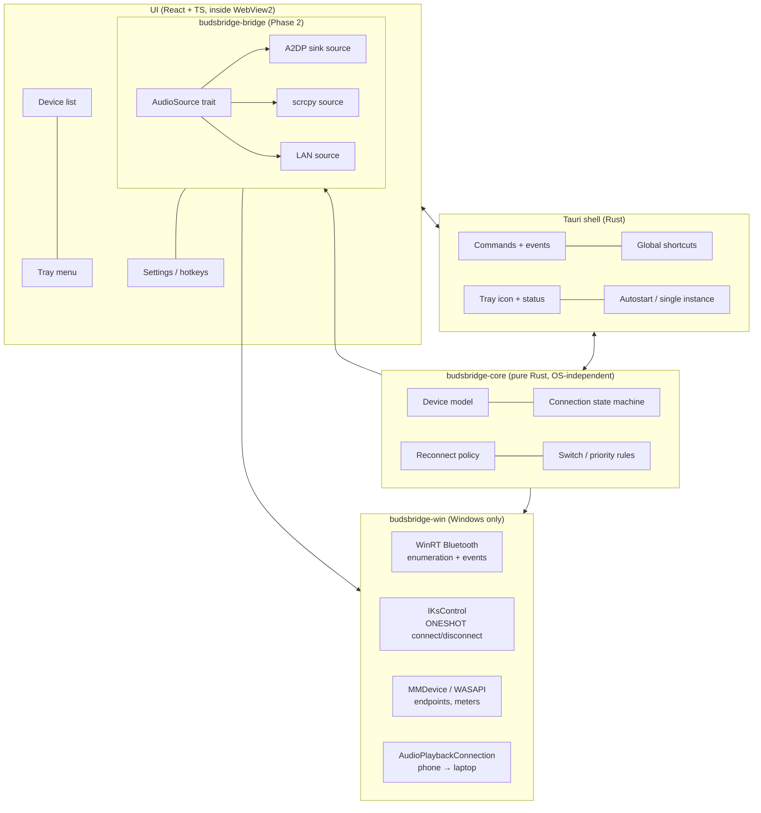
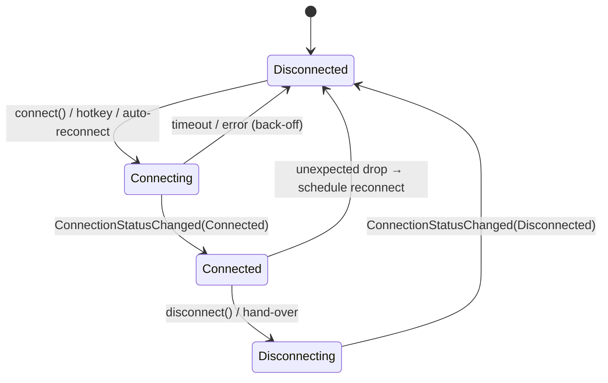

# BudsBridge: Architecture

> **Status:** ✅ **Approved (2026-10-20):** Tauri 2 + Rust core + React/TypeScript.
> Background and constraints: [FEASIBILITY.md](FEASIBILITY.md).

---

## 1. Recommended stack

| Layer | Choice | Why |
|-------|--------|-----|
| Desktop shell | **Tauri 2** | Small installer (about 10 MB). Tray icon, global shortcuts, autostart and single-instance are available as built-ins or plugins. Mica on Windows 11 through window effects |
| Native core | **Rust** + [`windows`](https://github.com/microsoft/windows-rs) crate (Microsoft's official bindings) | One crate covers all the APIs we need (WinRT Bluetooth, MMDevice/WASAPI, `IKsControl`, `AudioPlaybackConnection`). Rust keeps the COM code memory-safe |
| UI | **React + TypeScript + Vite**, with Fluent UI React v9 as a base | A web UI can match the reference design exactly. Fluent v9 gives a Windows 11 look for free where the design matches it |
| Phase 2 helper | **scrcpy** (bundled as a Tauri sidecar, Apache-2.0) + `adb` | Mature, well-tested audio forwarding. No need to reinvent it |
| Companion (optional) | **Kotlin + Jetpack Compose** Android app | Only needed for the Wi-Fi bridge and for Phase 3 phone-side detection |
| Tests | `cargo test` (core logic with fakes), Vitest + React Testing Library (UI), manual hardware checklist | CI has no Bluetooth hardware, so the logic is tested in isolation |
| CI | GitHub Actions on `windows-latest`: fmt, clippy, tests, `tauri build` | Every PR is built on real Windows |

### Why Tauri instead of WinUI 3

| | Tauri 2 (recommended) | WinUI 3 |
|---|---|---|
| Matches a custom reference design | ✅ Pixel-level control with CSS | ⚠️ Possible, but custom XAML styling takes a lot of work |
| Native Windows 11 feel | ⚠️ Close, using Mica plus Fluent UI web components | ✅ Native controls |
| Tray icon / hotkeys | ✅ Built in or plugin | ⚠️ Third-party library needed (no built-in tray) |
| Calling COM APIs (`IKsControl`, WASAPI) | ✅ `windows-rs`, type-safe | ⚠️ Verbose COM interop in C# |
| Installer size | ✅ About 10 MB (uses WebView2) | ⚠️ Larger (Windows App SDK runtime) |
| Testability | ✅ Core logic is a plain Rust crate | ⚠️ UI-heavy, harder to unit-test |
| Portfolio signal | ✅ Rust + TypeScript + native Windows APIs | ✅ C# / .NET |

**When WinUI 3 would win:** if the reference design is plain, stock
Windows 11 Fluent and you prefer C#. The choice can be made once the
screenshots are in. The Rust core (§3) stays useful either way.

---

## 2. High-level design



The core never calls Windows directly. It talks to traits, which keeps every
decision unit-testable:

```rust
// crates/budsbridge-core/src/backend.rs
pub trait DeviceBackend: Send + Sync {
    fn name(&self) -> &'static str;                  // "windows" | "demo"
    fn list_devices(&self) -> Result<Vec<AudioDevice>, BackendError>;
    fn connect(&self, id: &DeviceId) -> Result<(), BackendError>;    // a request; the result shows up in list_devices
    fn disconnect(&self, id: &DeviceId) -> Result<(), BackendError>;
    fn watch(&self, notify: ChangeNotifier) -> Result<Watch, BackendError>;
}

pub trait AudioSource: Send + Sync {               // Phase 2
    fn kind(&self) -> SourceKind;                   // A2dpSink | Scrcpy | Lan
    fn start(&self, target: &EndpointId) -> Result<()>;
    fn stop(&self) -> Result<()>;
    fn status(&self) -> SourceStatus;
}
```

### Connection state machine (per device)



The reconnect policy uses exponential back-off (1 s, 2 s, 4 s … up to 30 s,
with a maximum number of attempts). It is **suppressed** after a manual
disconnect or a hand-over, so the laptop never fights the phone.

---

## 3. Repository layout

```
BudsBridge/
├── apps/
│   └── desktop/
│       ├── src/                 # React UI
│       └── src-tauri/           # Tauri shell: commands, tray, hotkeys
├── crates/
│   ├── budsbridge-core/         # models, state machine, policies (tested on any OS)
│   ├── budsbridge-win/          # Windows backend (windows-rs)
│   └── budsbridge-bridge/       # Phase 2 audio sources
├── android/                     # optional companion app (Phase 2c / 3)
├── docs/
│   ├── FEASIBILITY.md
│   ├── ARCHITECTURE.md
│   ├── HARDWARE_TESTING.md      # manual checklist (spikes S1–S5)
│   └── adr/                     # short architecture decision records
└── .github/workflows/ci.yml
```

---

## 4. Milestones

Each milestone is a series of small, conventional commits (`feat:`, `fix:`,
`test:`, `docs:`, `ci:`, `chore:`).

| Milestone | Scope | Done when | Status |
|-----------|-------|-----------|--------|
| **M0** Scaffold | Workspace, Tauri app skeleton, CI, lint/format | CI is green on `windows-latest` | ✅ |
| **M1** Core | Device model, state machine, reconnect policy, settings | Unit tests cover all state transitions | ✅ |
| **M2** Windows backend | Enumerate paired audio devices, group endpoints by container, KS connect/disconnect, status events | Hardware spikes S1–S2 pass on your laptop | 🧪 listing confirmed on real hardware; connect/disconnect awaiting [hardware check](HARDWARE_TESTING.md) |
| **M3** MVP app | Tray icon with live status, device list, one-click connect/disconnect, global hotkeys, auto-reconnect, start with Windows | Manual checklist passes | 🧪 code done, awaiting [hardware check](HARDWARE_TESTING.md) |
| **M4** UI | Implement the reference design (Mica, dark/light) | Matches your screenshots | ⛔ blocked until screenshots arrive |
| **P2a** Bridge: Bluetooth | `AudioPlaybackConnection` source: the phone streams to the laptop and is heard on the earbuds | Spike S3 is acceptable | 🧪 code done (`core::bridge`, `win::phone`), awaiting [hardware check](HARDWARE_TESTING.md) |
| **P2b** Bridge: scrcpy | Bundled scrcpy/adb sidecar, audio-only, USB + Wi-Fi ADB | Spike S4 passes | ⏳ |
| **P2c** Bridge UI | Sources panel, per-source volume, latency indicator | — | ⏳ |
| **P3** Smart rules | Priority/ducking in hub mode, best-effort hand-over, optional companion app | Rules unit-tested; manual test | ⏳ |

---

## 5. Non-goals

- Firmware changes to earbuds, and "real" multipoint emulation. These are impossible (see FEASIBILITY §1).
- Kernel-mode drivers (virtual mic/speaker).
- Re-implementing the hands-free profile for calls (Phone Link already does this).
- iOS companion app. iPhone can still use **P2a**, because it is plain Bluetooth audio.

## 6. Privacy and security

- Everything runs locally. There is no cloud and no telemetry by default.
- LAN streaming (if built) only works after explicit pairing with a one-time
  code, and the stream is encrypted.
- scrcpy/adb only start when the user turns the bridge on.
