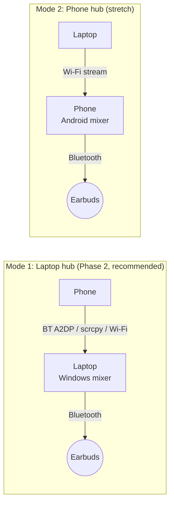

# BudsBridge: Feasibility Study

> **Status:** Draft v1 (2026-10-20). Desk research only. Nothing here has been
> checked on real hardware yet. Each claim that needs a real laptop, earbuds and
> phone is marked **[needs hardware check]** and is listed in
> [§9 Hardware spikes](#9-hardware-spikes-before-we-commit).

---

## TL;DR

| # | Question | Verdict |
|---|----------|---------|
| 1 | Can software make non-multipoint earbuds connect to a phone **and** a laptop at the same time? | ❌ **No.** Multipoint is a feature of the earbuds' firmware. No app on Windows or Android can add it. |
| 2 | Can Windows connect/disconnect paired earbuds with one click or a hotkey? | ✅ **Yes**, through a documented driver property (`KSPROPSETID_BtAudio`). It is the same mechanism behind *Sound settings → Connect*. |
| 3 | Can the laptop auto-reconnect the earbuds? | ✅ **Yes**, as long as the earbuds are not currently held by the phone. |
| 4 | Can the laptop "steal" the earbuds while they are connected to the phone? | ⚠️ **Depends on the earbuds.** Many single-point earbuds ignore a second host while they are busy. **[needs hardware check]** |
| 5 | Can the earbuds stay on the laptop while phone audio is played through them? (**Audio Bridge**) | ✅ **Yes, for media.** The phone's audio reaches the laptop over Bluetooth (the laptop acts as a speaker), USB/Wi-Fi ADB (scrcpy), or Wi-Fi (a companion app). Windows mixes it with laptop audio. Expect **+100–300 ms** extra delay. |
| 6 | Can phone **calls** go through the laptop to the earbuds? | ⚠️ **Yes, but not built by us.** Microsoft Phone Link already handles calls over Bluetooth. Call audio uses the low-quality hands-free (HFP) mode. |
| 7 | Can switching be fully automatic in both directions? | ⚠️ **Only partly.** Laptop to phone: best effort. Phone to laptop: not possible from a normal Android app (no public API). The bridge mode (#5) removes most of the need to switch. |

**Bottom line:** BudsBridge is worth building, but its honest pitch is not
"software multipoint". It is:

1. **Switch faster.** One-click or hotkey connect/disconnect, plus auto-reconnect (MVP).
2. **Stop switching.** The earbuds stay on the laptop and the phone's audio is bridged into it (Phase 2). In this mode the laptop works like a car stereo for the phone.

---

## 1. Why the problem exists

Classic Bluetooth earbuds have two audio roles:

- **A2DP sink:** receives high-quality stereo audio, with no microphone.
- **HFP hands-free unit:** two-way audio with a microphone, at low quality.

An earbud that is **not multipoint** keeps an audio link with **one host at a
time**. It can *remember* many paired hosts, but it only *connects* to one.
Multipoint means the earbud's firmware keeps two host links and decides which
one plays. This is purely a firmware feature. Sony, for example, says some of
its models gain multipoint through a firmware update, and that single-point
models "can't actively connect to two or more devices at once"
([Sony support][sony-multipoint]).

**Consequence:** nothing running on the laptop or the phone can change what the
earbuds' firmware allows. Every honest software fix has to work around it:

- **(a)** make the hand-over between hosts fast and automatic, or
- **(b)** make **one** host the only place the earbuds connect to, and route
  the other device's audio into that host.

BudsBridge does (a) in the MVP and (b) in Phase 2.

---

## 2. Windows: listing, connecting and disconnecting earbuds

### 2.1 Listing devices ✅

- **Bluetooth layer:** WinRT `Windows.Devices.Bluetooth.BluetoothDevice` gives
  paired devices, `ConnectionStatus`, and a `ConnectionStatusChanged` event.
- **Audio layer:** the MMDevice API (`IMMDeviceEnumerator`) lists audio
  endpoints. One pair of earbuds shows up as **several endpoints**, usually
  "Headphones" (A2DP) and "Headset" (HFP). They have to be grouped by device
  container ID. ToothTray, an open-source tray tool, documents exactly this
  ([ToothTray][toothtray]).

### 2.2 Connect / disconnect ✅ (with caveats)

WinRT has **no public "connect this headset" method**. The supported path is
one level lower:

- Windows defines the kernel-streaming property set `KSPROPSETID_BtAudio`
  with `KSPROPERTY_ONESHOT_RECONNECT` and `KSPROPERTY_ONESHOT_DISCONNECT`
  (enum `KSPROPERTY_BTAUDIO` in `ksmedia.h`) ([NtDoc][ntdoc-btaudio]).
- Microsoft's driver docs say a Bluetooth audio driver **must** support these
  two properties. When it does, the Sound control panel shows **Connect** /
  **Disconnect** for that endpoint ([MS: HFP device connection][ms-hfp],
  [MS: kernel streaming considerations][ms-ks]).
- A user-mode app sends them through `IKsControl` on the endpoint's KS filter.
  ToothTray proves this works without admin rights or a custom driver
  ([ToothTray][toothtray]).

**Caveats**

1. **It is asynchronous.** The request returns before the link is up, so
   BudsBridge must watch the connection events and use timeouts. It must not
   assume success.
2. **It needs free earbuds.** If the earbuds are busy with the phone, a
   single-point model usually ignores the laptop. Some models do accept the
   laptop and drop the phone ("last connection wins").
   **[needs hardware check: your earbuds]**
3. **It depends on the driver.** The in-box Microsoft stack is expected to
   work. Vendor Bluetooth stacks may not implement the property.
   **[needs hardware check: your adapter]**
4. **Fallback:** `BluetoothSetServiceState` (Win32) can switch the A2DP/HFP
   services off and on. It is slow, it reinstalls drivers, and it can need
   admin rights. We keep it only as a last resort.

### 2.3 Auto-reconnect ✅

BudsBridge listens for `ConnectionStatusChanged`. If the earbuds drop **and**
the user did not disconnect them on purpose, it retries with back-off
(1 s → 2 s → 4 s … up to 30 s, with a maximum number of attempts). A manual
disconnect, or a hand-over to the phone, pauses auto-reconnect so the laptop
does not fight the phone for the earbuds.

### 2.4 Tray icon and global hotkeys ✅

These are standard OS features: a notification-area icon, and `RegisterHotKey`
(or the Tauri global-shortcut plugin). There is no feasibility risk here.

---

## 3. Bluetooth profile limits: A2DP vs HFP

| Mode | Audio | Mic | Notes |
|------|-------|-----|-------|
| A2DP | Stereo, high quality | ❌ | Normal music/video mode |
| HFP | Mono, 8 kHz (CVSD) or 16 kHz (mSBC) | ✅ | Windows switches to it as soon as **any** app opens the earbuds' mic |
| LE Audio (LC3) | Stereo plus mic together | ✅ | Windows 11 24H2 or later. The PC radio, the driver **and** the earbuds must all support it ([heise][heise-le], [Microsoft LE Audio docs][ms-le]) |

**Impact on BudsBridge**

- While a laptop call (Teams, Discord, Phone Link) uses the earbuds' mic,
  **everything** the earbuds play is in HFP quality, bridged phone audio
  included. This is a Bluetooth Classic limit, not a BudsBridge bug.
- BudsBridge will **detect and show** whether the earbuds are in A2DP, HFP or
  LE Audio mode. It will not try to bypass this.
- Codec choice (SBC/AAC/aptX) belongs to Windows and the radio driver. An app
  cannot select it.

---

## 4. Latency budget

| Leg | Typical delay | Source / confidence |
|-----|---------------|---------------------|
| Laptop → earbuds, A2DP (SBC/AAC) | **~150–300 ms** (already present today) | RTINGS measured SBC at 173 ms on one headset ([RTINGS][rtings]). Lab averages for SBC/AAC on phones are about 300 ms or more ([DEV/SoundGuys summary][dev-latency]) |
| Phone → laptop via **scrcpy over USB** | ~60–120 ms | scrcpy's default audio buffer is 50 ms and its output buffer is 10 ms, plus Opus encode/decode ([scrcpy audio docs][scrcpy-audio]). The total is an estimate |
| Phone → laptop via **scrcpy over Wi-Fi** | ~80–200 ms | Same as USB, plus network jitter. A bigger buffer is safer (scrcpy suggests 200 ms for audio-only use) |
| Phone → laptop via **Bluetooth A2DP sink** | ~150–250 ms | A second full A2DP hop. It shares the radio with the earbuds link. **[needs hardware check]** |
| Phone → laptop via **companion app over Wi-Fi** (Opus/UDP) | ~40–150 ms | Mostly set by the jitter buffer. Estimate |

**Total for phone audio heard through the earbuds: about 250–500 ms.**

- ✅ Fine for music, podcasts, voice notes, and video played or mirrored *on the laptop*.
- ⚠️ Video watched **on the phone's own screen** will be visibly out of sync.
  People start to notice at about 125 ms (ITU-R BT.1359, cited in
  [DEV][dev-latency]). Mirroring the phone with scrcpy keeps picture and sound
  together on the laptop.
- ❌ Not suitable for rhythm games or live monitoring.

---

## 5. Phase 2: three ways to get phone audio onto the laptop

### Option A: the laptop acts as a Bluetooth speaker (`AudioPlaybackConnection`) ✅ recommended first

- Windows 10 2004 (build 19041) and later can act as an **A2DP sink**. The
  phone sees the laptop as a speaker. An app has to open and manage the
  connection through `Windows.Media.Audio.AudioPlaybackConnection`
  ([MS: enable remote audio playback][ms-remote-audio]). The open-source
  *AudioPlaybackConnector* already does this
  ([AlternativeTo listing][apc]).
- **Pros:** no phone app, no cable, no developer mode. It works with **iPhone
  too**, because it is plain Bluetooth audio.
- **Cons:**
  - The laptop's single radio carries two audio links at once (receiving from
    the phone, sending to the earbuds). Users report stutter when a phone and
    a headset are both connected to one PC
    ([ElevenForum][eleven-stutter], [MS Q&A][msqa-stutter]).
    **[needs hardware check]**
  - Media only. Calls are not routed this way (see §5.4).
  - BudsBridge has to keep running to hold the connection. As a tray app, it does.

### Option B: scrcpy audio forwarding over ADB ✅ best quality and control

- Needs **Android 11 or later** and USB debugging, or wireless debugging. On
  Android 11 the screen must be unlocked when capture starts. Android 12 and
  later work out of the box ([scrcpy audio docs][scrcpy-audio]).
- `--audio-source=output` (the default) captures all phone audio and **mutes
  the phone speaker**.
- `--audio-source=playback --audio-dup` (Android 13 and later) keeps the phone
  playing too, but **apps can opt out** of capture.
- Audio-only mode (`--no-video --no-control`, or `--no-window`) suits a
  background bridge. scrcpy is Apache-2.0 licensed, so it can ship as a
  bundled helper.
- **Calls:** scrcpy has `voice-call*` audio sources. Whether a non-rooted
  stock phone allows capturing call audio is **not guaranteed**, so we treat
  it as unsupported until tested. **[needs hardware check]**
- **Cons:** enabling developer options is friction for non-technical users.

### Option C: Android companion app over Wi-Fi ⏳ later

- `MediaProjection` plus `AudioPlaybackCaptureConfiguration` (Android 10 and
  later) captures other apps' audio, which is then streamed as Opus to the
  laptop.
- **Limits:** the user must accept a consent prompt each session. Only audio
  with usage `MEDIA`, `GAME` or `UNKNOWN` **and** a permissive capture policy
  can be captured. Apps can opt out, and calls are never capturable
  ([Android: audio playback capture][android-capture]).
- This is the most work. It only pays off when there is no Bluetooth and no
  ADB.

### 5.4 Mixing and calls

- **Mixing is free:** the Windows audio engine already mixes every stream sent
  to the same output. BudsBridge does **not** need a virtual audio driver for
  Phase 2. The bridged phone stream gets its own slider in the Windows Volume
  Mixer, and BudsBridge adds a per-source volume control.
- **Out of scope:** a virtual mic/speaker driver, for example to feed phone
  audio into Zoom. That needs a signed kernel-mode driver.
- **Phone calls while the earbuds are on the laptop:** Microsoft **Phone Link**
  already makes and receives Android calls over Bluetooth (Android 10 or
  later, PC with Bluetooth) ([MS support: calls in Phone Link][ms-phonelink]).
  The call plays on the laptop's default communication device, which is the
  earbuds. BudsBridge will detect and guide this rather than re-implement the
  hands-free profile.

---

## 6. Reverse flow: earbuds on the phone, laptop audio sent to the phone

This flow is technically feasible. It is planned as a **later, optional mode**.

```
Laptop (WASAPI loopback capture) --Wi-Fi, Opus--> Android companion app --> phone mixer --> Earbuds (Bluetooth)
```

| ✅ Pros | ❌ Cons |
|---------|---------|
| Phone calls are native, best quality | Needs a companion app running as a foreground service (battery use) |
| The earbuds follow you when you walk away from the laptop | Wi-Fi adds 50–150 ms and drops when the network does |
| No developer mode on the phone | For laptop meetings, the phone's mic cannot reach Windows without a virtual-mic driver (out of scope). The laptop's built-in mic is used instead |
| | Apps such as AudioRelay and SoundWire already do this, so it adds less to the portfolio |

**Recommendation:** make **laptop-as-hub** (§5) the primary mode, and keep
**phone-as-hub** as a stretch goal.



---

## 7. Phase 3: auto-switch, what is really possible

| Capability | Feasible? | How |
|------------|-----------|-----|
| Detect laptop playback | ✅ | WASAPI audio sessions and peak meters (`IAudioMeterInformation`) |
| Detect laptop mic in use (a call) | ✅ | Windows capability-access "in use" state for the microphone |
| Detect phone playback / calls | ✅ with companion app | `AudioManager`, `MediaSessionManager` (notification-listener permission), `TelephonyCallback` |
| Laptop releases earbuds | ✅ | `KSPROPERTY_ONESHOT_DISCONNECT` |
| Phone grabs earbuds automatically | ⚠️ best effort | No public Android API. `BluetoothA2dp.connect()` is `@hide`, and calling it through reflection is an unsupported hack ([AOSP source][aosp-a2dp]). We rely on the earbuds/phone auto-reconnecting, or a one-tap notification that opens Bluetooth settings |
| Phone releases earbuds so the laptop can take them | ❌ for normal apps | No public disconnect API. Apps targeting Android 13 or later can no longer switch Bluetooth off. Root or Shizuku could work, but is experimental and off by default |

**Honest consequence:** fully automatic two-way switching is not possible on
stock Android. So Phase 3 is redefined:

1. **In laptop-hub mode** (no switching needed): smart **priority and ducking**.
   For example, when a laptop call starts, pause or duck the phone stream.
   Phone calls go through Phone Link.
2. **In classic switching mode:** a best-effort hand-over from laptop to phone
   (release, then wait for the phone), triggered by rules such as "phone
   started playing and the laptop is idle".

---

## 8. Development and testing constraints

- Windows-specific code (Bluetooth, audio, KS) sits behind Rust traits. The
  logic (state machine, reconnect policy, switch rules) is unit-tested with
  fakes on any OS.
- CI runs on GitHub Actions `windows-latest` to build and test. **CI runners
  have no Bluetooth hardware**, so real-device behaviour is covered by a manual
  checklist (`docs/HARDWARE_TESTING.md`, to be added) that you run on your
  laptop.
- Target: **Windows 11** (Mica is Windows 11 only, and Windows 10 support ended
  in October 2025). Windows 10 22H2 is best effort, with no Mica.

---

## 9. Hardware spikes before we commit

These are short experiments to run on your machine before the MVP is called done:

1. **S1:** KS connect/disconnect works with *your* earbuds and Bluetooth
   adapter. Measure the time to connect.
2. **S2:** Do your earbuds accept a laptop connect while they are connected to
   the phone? Takeover vs ignore.
3. **S3:** `AudioPlaybackConnection` (phone → laptop) **and** earbuds at the
   same time. Check for stutter, with and without Wi-Fi in use.
4. **S4:** scrcpy audio on your phone: Android version, `output` vs `playback`,
   and whether a `voice-call` source works.
5. **S5:** End-to-end latency for each bridge option (a click/clap test is enough).

---

## Sources

- Sony: multipoint / multiple-device pairing: [sony-multipoint]
- Microsoft: HFP device connection (`KSPROPERTY_ONESHOT_*`): [ms-hfp]
- Microsoft: kernel streaming considerations: [ms-ks]
- NtDoc: `KSPROPERTY_BTAUDIO` (`ksmedia.h`): [ntdoc-btaudio]
- ToothTray (m2jean): user-mode connect/disconnect via `IKsControl`: [toothtray]
- Microsoft: enable remote audio playback (`AudioPlaybackConnection`): [ms-remote-audio]
- AudioPlaybackConnector (open source A2DP-sink tray app): [apc]
- scrcpy audio documentation: [scrcpy-audio]
- Android: audio/video playback capture: [android-capture]
- AOSP `BluetoothA2dp.java` (`connect()` is `@hide`): [aosp-a2dp]
- Microsoft support: setting up calls in Phone Link: [ms-phonelink]
- RTINGS: headphone latency: [rtings]
- DEV Community: Bluetooth latency summary (cites SoundGuys, ITU-R BT.1359): [dev-latency]
- heise: Windows 11 LE Audio: [heise-le]
- Microsoft: Bluetooth LE Audio driver docs: [ms-le]
- ElevenForum / Microsoft Q&A: stutter with several Bluetooth devices: [eleven-stutter], [msqa-stutter]

[sony-multipoint]: https://www.sony-mea.com/en/electronics/support/audio-video-headphones/articles/00230558
[ms-hfp]: https://learn.microsoft.com/en-us/windows-hardware/drivers/audio/hfp-device-connection
[ms-ks]: https://learn.microsoft.com/en-us/windows-hardware/drivers/audio/kernel-streaming-considerations
[ntdoc-btaudio]: https://ntdoc.m417z.com/ksproperty_btaudio
[toothtray]: https://github.com/m2jean/ToothTray
[ms-remote-audio]: https://learn.microsoft.com/windows/apps/develop/media-playback/enable-remote-audio-playback
[apc]: https://alternativeto.net/software/audioplaybackconnector/about
[scrcpy-audio]: https://github.com/Genymobile/scrcpy/blob/master/doc/audio.md
[android-capture]: https://developer.android.com/media/platform/av-capture
[aosp-a2dp]: https://code.yawk.at/android/android-9.0.0_r35/android/bluetooth/BluetoothA2dp.java
[ms-phonelink]: https://support.microsoft.com/help/4531605
[rtings]: https://www.rtings.com/headphones/learn/latency
[dev-latency]: https://dev.to/keyboard-testerclick/your-bluetooth-headphones-are-300-ms-late-measure-it-in-one-browser-tab-2idp
[heise-le]: https://heise.de/-10626470
[ms-le]: https://learn.microsoft.com/en-us/windows-hardware/drivers/bluetooth/bluetooth-low-energy-audio
[eleven-stutter]: https://www.elevenforum.com/t/bluetooth-headset-audio-stuttering-if-multiple-bluetooth-devices-are-connected.5196/
[msqa-stutter]: https://learn.microsoft.com/pt-br/answers/questions/5491725/problema-no-audio-bluetooth-quando-vinculado-ao-te
